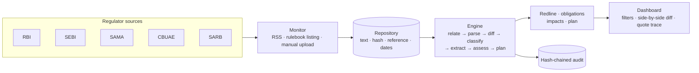
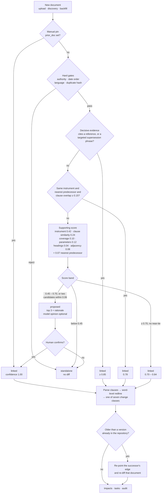

# Regula

**Regulatory Change Impact Agent** — tracks regulatory publications, detects what changed
against the earlier version, extracts the affected obligations and shows the impact on a
bank's policies, processes, systems and controls — with human review and a hash-chained audit
trail.

Built for the Azentio.ai Build Labs hackathon, Challenge 02.

---

## The problem

Compliance teams read circulars by hand, compare them with earlier instructions and work out
which internal policies, processes and systems must change. It is slow, inconsistent across
jurisdictions and hard to evidence to an auditor. Regula turns that reading into a traceable
decision chain: **regulation → clause → obligation → impacted asset → owner → approval**.

## What it does

- **Monitor** configured regulator sources and fetch new publications; keep a searchable
  repository with a content hash per document.
- **Understand** each document: numbered clauses, obligations with a verbatim quote and clause
  reference, deadlines, thresholds, applicability.
- **Compare** a publication with the earlier regulation it repeals or amends: side-by-side
  text, word-level redline, and a plain-English significance sentence.
- **Classify** every change: new obligation, modified, withdrawn, deadline extended, deadline
  shortened, clarification, or no material change.
- **Assess impact** against a control library (policies, processes, systems, controls), with a
  numeric gap, severity score and ownership.
- **Plan and prove**: owned tasks with due dates, human approval, and a SHA-256 hash chain over
  every extraction, approval and status change.

## Architecture

The engine is one block. Discovery feeds it, the audit chain records it, the dashboard reads it.



The interesting part is the first step inside that block: deciding **which** earlier document to
compare against. Getting this wrong is worse than declining — a false link turns every clause
into a change and fabricates a whole impact assessment — so the engine is allowed to abstain.

### How the engine selects a document and scores the relationship



A few properties worth calling out:

- **Recall and warrant are separate.** Hard gates plus an IDF-ranked instrument identity decide
  *what could* be a predecessor; citation, supersession language and clause evidence decide
  *whether it is one*. Topical similarity alone is a sibling, not a version.
- **Clause-level similarity, not document cosine.** An amendment is often a fifth the length of
  the consolidated instrument it amends, so a global cosine buries the signal. Each new clause
  is matched against its best counterpart in the candidate.
- **The version chain outranks global similarity.** The predecessor is the nearest earlier
  version of the same instrument, ordered by publication date — or by the fiscal year encoded in
  the reference when no date is stated.
- **Backfill is a first-class path.** Uploading an older circular re-points the successor's edge
  and re-diffs it, so history arriving late does not leave a stale comparison behind.
- **A manual pin always wins.** A declared `prior_doc` skips inference entirely: the demo stays
  deterministic even if scoring changes.
- **The model only advises.** When configured, it is given the shortlist and may argue for one
  candidate or for none. Its opinion is attached to a `proposed` result; it never creates a link.

| Constant | Value | What it buys |
|---|---|---|
| `DECISIVE` | 0.85 | confidence floor for an evidence-backed link |
| `AUTO_LINK` | 0.70 | weak-score ceiling for an automatic diff |
| `PROPOSE_FLOOR` | 0.45 | below this a document is standalone, not "unresolved" |
| `AMBIGUITY_MARGIN` | 0.06 | a near-tie always goes to a human |
| `IDENTITY_CONTENT_FLOOR` | 0.15 | stops a same-titled but unrelated document from auto-linking |

### How a change is detected

1. **New vs already processed** — the extracted text is hashed (SHA-256); an unchanged hash
   means the document is skipped. Each fetch records the document, its hash and timestamps.
2. **Which prior document** — `regula/relate.py` gates on authority, date order, language and
   duplicate hash, then scores the survivors on instrument identity, cited references,
   supersession language, clause-level similarity, parameter overlap and chain adjacency.
   Decisive evidence links automatically; anything in the grey band comes back as *proposed*
   with its top three candidates and a rationale, and waits for a human instead of guessing.
3. **Which clause changed** — the new document is parsed into numbered clauses and diffed
   against the prior document at word level: added, modified, removed.
4. **What kind of change** — an AI pass maps each clause to its prior counterpart and assigns
   one of the seven change classes plus a one-sentence significance. Deterministic rules still
   produce a class if the model is unavailable.
5. **Who decides** — every acceptance or rejection is a human action recorded in the audit
   chain.

### Persistence

There is one database: `backend/data/db.json`, written by `regula/store.py` on every mutation. An
upload is persisted in full — the source record, its clauses, obligations, impacts, tasks, the
relationship decision, any backfill it caused and the audit events — not just held in memory. An
`uploads` ledger keeps the extracted body beside its SHA-256, byte size, uploader and timestamp, so
a lost `data/uploads` file is rebuilt from the database on the next load. Uploads pin the database:
once one exists, a seed rebuild will not run over it.

### Sources

| Region | Authority | Website | Discovery |
|---|---|---|---|
| India | RBI | https://www.rbi.org.in/ | RSS: https://rbi.org.in/notifications_rss.xml |
| India | SEBI | https://www.sebi.gov.in/ | RSS: https://www.sebi.gov.in/sebirss.xml |
| KSA | SAMA | https://rulebook.sama.gov.sa/ | Rulebook circular listing (no RSS) |
| UAE | CBUAE | https://rulebook.centralbank.ae/ | Rulebook listing (no RSS; seed fallback) |
| South Africa | SARB | https://www.resbank.co.za/ | RSS: https://www.resbank.co.za/bin/sarb/solr/publications/rss |

The Indian and South African regulators publish RSS feeds, which `POST /api/discover`
consumes. SAMA and CBUAE publish through HTML rulebooks instead — the discovery step parses
their listing pages and falls back to a seeded publication when the site is unavailable, so
the repository always carries the configured jurisdictions.

The committed demo documents are the RBI **Digital Lending** pair:

- 2022 Guidelines — https://www.rbi.org.in/Scripts/NotificationUser.aspx?Id=12382&Mode=0
- 2025 Directions — https://www.rbi.org.in/Scripts/NotificationUser.aspx?Id=12848&Mode=0

`backend/scrape.py` reproduces both text files from those pages; `backend/data/scrape-manifest.json`
records the source URL and content hash.

## Repository

```
backend/
  serve.py              stdlib JSON API
  scrape.py             automated fetch + extraction for configured sources
  regula/
    ingest.py           clause parsing, prior alignment, redline
    extract.py          obligations with quotes, params, deadlines
    enrich.py           AI alignment, change class, significance
    changes.py          change taxonomy across the repository
    discover.py         source monitoring (feeds + offline mirrors)
    rss.py              RSS / rulebook discovery and ingestion
    relate.py           predecessor selection and relationship scoring
    upload.py           manual upload: extraction, relate, backfill
    extract_api.py      preview extraction + relationship for a pasted document
    match.py            asset matching over the control library
    assess.py           severity, numeric gap, rationale, effort
    planner.py          owned tasks, dependencies, due dates
    pipeline.py         run orchestration
    audit.py            SHA-256 hash chain
    store.py            state, persistence, report export
  data/                 documents, prior versions, inventory, regulators
frontend/
  app/                  Next.js routes (dashboard, publication detail)
  components/dashboard/ dashboard, clause diff, obligation card, filters
  lib/                  contract types, domain adapters, state fetch
contracts/api.md        API contract
docs/                   requirements, plan, demo script
```

## Run it

**Backend** (Python stdlib only):

```bat
run.cmd                 :: starts backend/serve.py on :8787
python backend\serve.py --reset
python backend\scrape.py            :: refresh the India sources
python backend\scrape.py --check    :: fetch and compare without writing
python backend\export_mock.py       :: regenerate the offline fixtures
```

**Frontend** (Next.js):

```bat
cd frontend
npm ci
npm run dev             :: http://localhost:3000
```

The frontend reads `GET http://127.0.0.1:8787/api/state` server-side and falls back to
`frontend/mock/state.json` with a visible degraded banner if the API is down.

**AI enrichment** is a direct OpenAI-compatible call (no provider abstraction, no offline
cache). Add a repo-root `.env`:

```ini
REGULA_LLM_BASE_URL=https://openrouter.ai/api/v1
REGULA_LLM_MODEL=z-ai/glm-5.3-flash
REGULA_LLM_API_KEY=...
```

Without a key the deterministic pipeline still runs; enrichment fields stay empty.

## API

| Method | Path | Purpose |
|---|---|---|
| GET | `/api/state` | Full workspace: sources, clauses, obligations, impacts, tasks, audit |
| GET | `/api/changes` | Classified change list with counts by class |
| GET | `/api/export/{sourceId}.md` | Assessment pack as markdown |
| POST | `/api/discover` | RSS discovery (RBI + SEBI), dedupe by URL, ingest newest directives |
| POST | `/api/extract` | Preview text, obligations and the relationship for a pasted document |
| POST | `/api/sources/upload` | Upload TXT/DOCX/PDF/HTML, relate it, diff it, backfill successors |
| POST | `/api/sources/{id}/relate` | Re-run relationship inference; `{apply:true}` accepts a link |
| POST | `/api/sources/{id}/link` | Confirm a predecessor from the grey band and re-run the diff |
| POST | `/api/sources/{id}/run` | Analyse one publication |
| POST | `/api/impacts/{id}/review` | Approve or reject an impact |
| POST | `/api/tasks/{id}/status` | Move a task through its workflow |
| POST | `/api/reset` | Rebuild from seed |
| GET | `/api/health` | Liveness |

## Data honesty

The RBI documents are real and publicly available; the text is extracted from the official
notification pages. The 2025 Directions explicitly repeal the 2022 Guidelines. The control
library is a curated model of a mid-size Indian bank's KYC and lending stack, not an import
from a GRC system. The optional LLM is used for alignment, classification and significance;
every obligation still carries a verbatim quote and clause reference.

Known limits: PDF text extraction is best-effort — a scanned PDF is accepted and flagged
`needs_ocr` rather than guessed at; SEBI monitoring is configured but not yet fetched live; the
relationship weights are hand-tuned for the demo and exposed as constants in `relate.py`; and
approval is a demo identity rather than SSO.

Roadmap: OCR for scanned PDFs, live SEBI ingestion, scheduled monitoring, control-library
import, reviewer workflow and a labelled relationship benchmark.
