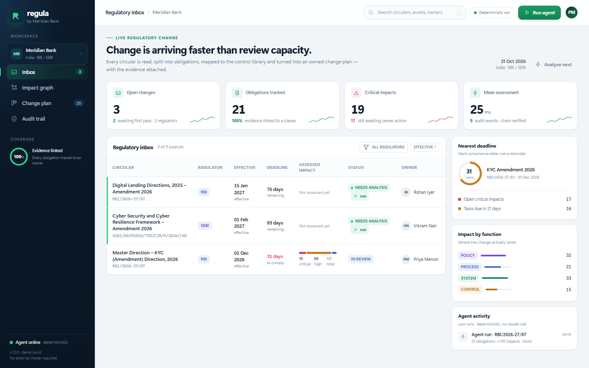

# Regula

**Regulatory Change Impact Agent** — track a regulatory change, assess policy / process / system impact, and produce an audit-ready change plan.

Built for the Azentio.ai Build Labs hackathon, Challenge 02.



---

## Run it

**Backend** — Python stdlib only, no install:

```bat
run.cmd        :: legacy entry point, now starts backend/serve.py on :8787
```

Or directly: `python backend\serve.py --reset` (rebuilds the demo workspace from seed).

**Frontend** — Next.js dashboard, one install:

```bat
cd frontend
npm ci
npm run dev    :: http://localhost:3000
```

The frontend reads `GET http://127.0.0.1:8787/api/state` server-side and falls back to
`frontend/mock/state.json` with a visible degraded banner when the API is down.

**AI enrichment** (clause alignment, change class, plain-English significance) is a direct
OpenAI-compatible call. Put the key in the repo-root `.env`:

```ini
REGULA_LLM_BASE_URL=https://openrouter.ai/api/v1
REGULA_LLM_MODEL=z-ai/glm-5.3-flash
REGULA_LLM_API_KEY=...
```

Without a key the pipeline still runs; enrichment fields simply stay empty.

The canonical app is `backend/` (API + engine) and `frontend/` (Next.js dashboard).

---

## What it does

```
circular → clauses + redline → obligations → asset graph → scored impact → change plan → audit chain
```

- **Clause redline.** Section-level diff against the prior version, word-level additions and deletions.
- **Obligations.** Extracted with a verbatim quote, clause reference, modality, deadline and confidence.
- **Asset graph.** Every obligation is mapped to policies, processes, systems and controls with a match score and shared tags.
- **Numeric gap.** Machine-readable parameters (`review_cycle_months`, `bo_threshold_pct`, `retention_years`, …) are compared to the bank's current configuration. `24 → 12`, `25% → 10%`, `5 years → 8 years`.
- **Impact score.** Criticality × change type × urgency × gap, with a written rationale and effort estimate.
- **Change plan.** One owned task per impacted asset, priority, due date derived from the effective date, dependency on the policy change.
- **Evidence chain.** SHA-256 hash chain over every extraction, approval and status change. Exportable assessment pack.

No LLM is required for the deterministic pipeline. When `REGULA_LLM_*` is configured, a
direct OpenAI-compatible call aligns each new clause with its prior counterpart, classifies
the change, and writes a plain-English significance sentence; failures fall back to the
deterministic output.

---

## The demo path

1. **Dashboard** — publications across regions, filters by authority / change class / state, and a
   "Run monitoring" strip.
2. Open **RBI (Digital Lending) Directions, 2025** (live document, fetched from rbi.org.in).
3. **Clause comparison** — previous 2022 guideline text next to the 2025 text, word-level
   highlights and the AI significance sentence.
4. Click an obligation's clause reference — the exact quote is marked in the source text.
5. **Review state** and the hash-chained audit trail record every human decision.

---

## Architecture

```
backend/
  serve.py              stdlib ThreadingHTTPServer, JSON API
  regula/
    ingest.py           clause parser, prior alignment, redline
    extract.py          obligation extraction with quotes and params
    enrich.py           AI alignment, change class, significance
    changes.py          change taxonomy across the corpus
    discover.py         source monitoring (feeds + offline mirrors)
    extract_api.py      manual upload / text extraction
    match.py            TF-IDF over the asset inventory
    assess.py           score, severity, delta, effort
    planner.py          owned tasks, dependencies, due dates
    pipeline.py         run orchestration with per-step timings
    audit.py            SHA-256 prev-hash chain
    store.py            state assembly, persistence, report export
  data/                 circulars, prior versions, inventory, regulators
frontend/
  app/                  Next.js routes (dashboard, publications/[id])
  components/dashboard/ dashboard, clause diff, obligation card, filters
  lib/                  contract types, domain adapters, state fetch
contracts/api.md        frozen API contract
docs/                   plan, requirements, demo script
```

**Why the split?** The engine stays stdlib-only, so it runs without an install; the dashboard
is a Next.js app that reads the single `GET /api/state` document and degrades to a fixture
when the API is unreachable.

---

## API

| Method | Path | Purpose |
|---|---|---|
| GET | `/api/state` | Whole workspace: sources, clauses, obligations, assets, impacts, tasks, audit, runs, summary |
| POST | `/api/sources/{id}/run` | Run the agent on one source |
| POST | `/api/impacts/{id}/review` | `{decision: "approved"\|"rejected", note, actor}` |
| POST | `/api/tasks/{id}/status` | `{status: "proposed"\|"approved"\|"in_progress"\|"done", actor}` |
| GET | `/api/export/{sourceId}.md` | Download the assessment pack |
| POST | `/api/reset` | Rebuild from seed |
| GET | `/api/health` | Liveness |

Full field definitions: [`contracts/api.md`](contracts/api.md).

---

## Demo data honesty

The circulars are realistic but synthetic, written for the demo. The prior-versions file exists so the redline is real. The asset inventory is a curated model of a mid-size Indian bank's KYC and lending stack; every asset has an owner, a current state and parameters that conflict with the amendment.

The engine is real: it parses, extracts, maps, scores, plans and hashes whatever is in `app/data/`.

---

## Known limits (say this before a judge does)

- PDF/OCR ingestion is not wired; documents are text files.
- The asset inventory is curated, not imported from ServiceNow/Archer.
- Scoring weights are hand-tuned for the demo, not calibrated on a labelled gold set.
- Approval is a demo identity, not SSO.
- The optional LLM adapter is a stub.

Roadmap: PDF extraction, control-library import, Jira/ServiceNow sync, reviewer workflow, gold-set accuracy benchmark.

---

## License

Internal hackathon prototype. Not for production use.
