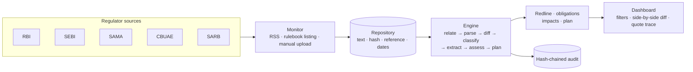
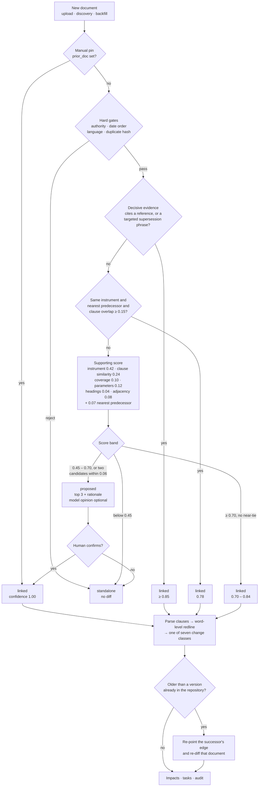
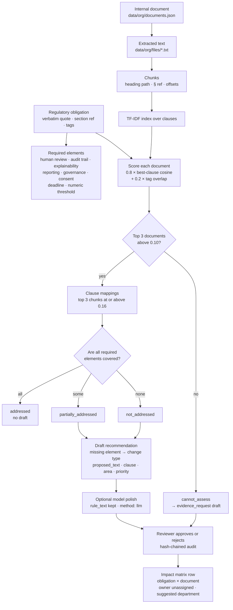

<h1 align="center">Regula</h1>

<p align="center">
  
</p>

**Regulatory Change Impact Agent** - tracks regulatory publications, detects what changed
against the earlier version, extracts the affected obligations and shows the impact on a
bank's policies, processes, systems and controls - with human review and a hash-chained audit
trail.

Built for the Azentio.ai Build Labs hackathon, Challenge 02.

---

## The problem

Compliance teams read circulars by hand, compare them with earlier instructions and work out
which internal policies, processes and systems must change. It is slow, inconsistent across
jurisdictions and hard to evidence to an auditor. Regula turns that reading into a traceable
decision chain: **regulation → clause → obligation → impacted asset → owner → approval**.

## What it does

- **Monitor** configured regulator sources and fetch new publications; keep a searchable
  repository with a content hash per document.
- **Understand** each document: numbered clauses, obligations with a verbatim quote and clause
  reference, deadlines, thresholds, applicability.
- **Compare** a publication with the earlier regulation it repeals or amends: side-by-side
  text, word-level redline, and a plain-English significance sentence.
- **Classify** every change: new obligation, modified, withdrawn, deadline extended, deadline
  shortened, clarification, or no material change.
- **Assess impact** against a control library (policies, processes, systems, controls), with a
  numeric gap, severity score and ownership.
- **Map internally**: link each obligation to the internal clause that should cover it, state the
  compliance gap, and draft the specific policy change for a reviewer to approve.
- **Plan and prove**: owned tasks with due dates, human approval, and a SHA-256 hash chain over
  every extraction, approval and status change.

## Frontend

The Next.js app is organised into three main pages:

- **Home (`/`)** gives a compliance score and its breakdown, headline counts, critical gaps,
  upcoming deadlines and open tasks by department. The figures link to the records behind them.
- **Regulatory (`/regulatory`)** is the publication repository, with status queues and filters.
  From here, reviewers can upload a circular, run regulator discovery, configure scheduled sync
  and open a publication to inspect its changes and impacts. The older `/publications` route
  redirects here while preserving its filters.
- **Organisation (`/organisation`)** manages the internal records used to understand regulatory
  impact. Its Documents, Assets and People tabs each show record counts and support adding and
  removing records:
  - **Documents** accepts multiple PDF, DOCX, TXT, Markdown, HTML or CSV files (up to 8 MB each).
    Set the document type, department, owner, version and next review date for each upload batch;
    browse the repository by document type and see overdue reviews.
  - **Assets** covers systems, processes, controls and policies. Add one at a time or import a
    CSV; include its owner, department, criticality, description and tags. Assets are used to
    assess future regulatory changes.
  - **People** is the owner directory. Add a person with their name, work email, department and
    designation, or import a CSV. The directory supplies owner suggestions when adding documents
    and assets.

  CSV imports use the first row as the header and are validated as a whole; if a row is invalid,
  the import is rejected rather than partially applied.

## Architecture

The engine is one block. Discovery feeds it, the audit chain records it, the dashboard reads it.



The interesting part is the first step inside that block: deciding **which** earlier document to
compare against. Getting this wrong is worse than declining - a false link turns every clause
into a change and fabricates a whole impact assessment - so the engine is allowed to abstain.

### How the engine selects a document and scores the relationship



A few properties worth calling out:

- **Recall and warrant are separate.** Hard gates plus an IDF-ranked instrument identity decide
  *what could* be a predecessor; citation, supersession language and clause evidence decide
  *whether it is one*. Topical similarity alone is a sibling, not a version.
- **Clause-level similarity, not document cosine.** An amendment is often a fifth the length of
  the consolidated instrument it amends, so a global cosine buries the signal. Each new clause
  is matched against its best counterpart in the candidate.
- **The version chain outranks global similarity.** The predecessor is the nearest earlier
  version of the same instrument, ordered by publication date - or by the fiscal year encoded in
  the reference when no date is stated.
- **Backfill is a first-class path.** Uploading an older circular re-points the successor's edge
  and re-diffs it, so history arriving late does not leave a stale comparison behind.
- **A manual pin always wins.** A declared `prior_doc` skips inference entirely: the demo stays
  deterministic even if scoring changes.
- **The model only advises.** When configured, it is given the shortlist and may argue for one
  candidate or for none. Its opinion is attached to a `proposed` result; it never creates a link.

| Constant | Value | What it buys |
|---|---|---|
| `DECISIVE` | 0.85 | confidence floor for an evidence-backed link |
| `AUTO_LINK` | 0.70 | weak-score ceiling for an automatic diff |
| `PROPOSE_FLOOR` | 0.45 | below this a document is standalone, not "unresolved" |
| `AMBIGUITY_MARGIN` | 0.06 | a near-tie always goes to a human |
| `IDENTITY_CONTENT_FLOOR` | 0.15 | stops a same-titled but unrelated document from auto-linking |

### How a change is detected

1. **New vs already processed** - the extracted text is hashed (SHA-256); an unchanged hash
   means the document is skipped. Each fetch records the document, its hash and timestamps.
2. **Which prior document** - `regula/relate.py` gates on authority, date order, language and
   duplicate hash, then scores the survivors on instrument identity, cited references,
   supersession language, clause-level similarity, parameter overlap and chain adjacency.
   Decisive evidence links automatically; anything in the grey band comes back as *proposed*
   with its top three candidates and a rationale, and waits for a human instead of guessing.
3. **Which clause changed** - the new document is parsed into numbered clauses and diffed
   against the prior document at word level: added, modified, removed.
4. **What kind of change** - an AI pass maps each clause to its prior counterpart and assigns
   one of the seven change classes plus a one-sentence significance. Deterministic rules still
   produce a class if the model is unavailable.
5. **Who decides** - every acceptance or rejection is a human action recorded in the audit
   chain.

### Persistence

There is one database: `backend/data/db.json`, written by `regula/store.py` on every mutation. An
upload is persisted in full - the source record, its clauses, obligations, impacts, tasks, the
relationship decision, any backfill it caused and the audit events - not just held in memory. An
`uploads` ledger keeps the extracted body beside its SHA-256, byte size, uploader and timestamp, so
a lost `data/uploads` file is rebuilt from the database on the next load. Uploads pin the database:
once one exists, a seed rebuild will not run over it.

### Sources

| Region | Authority | Website | Discovery |
|---|---|---|---|
| India | RBI | https://www.rbi.org.in/ | RSS: https://rbi.org.in/notifications_rss.xml |
| India | SEBI | https://www.sebi.gov.in/ | RSS: https://www.sebi.gov.in/sebirss.xml |
| KSA | SAMA | https://rulebook.sama.gov.sa/ | Rulebook circular listing (no RSS) |
| UAE | CBUAE | https://rulebook.centralbank.ae/ | Rulebook listing (no RSS; seed fallback) |
| South Africa | SARB | https://www.resbank.co.za/ | RSS: https://www.resbank.co.za/bin/sarb/solr/publications/rss |

The Indian and South African regulators publish RSS feeds, which `POST /api/discover`
consumes. SAMA and CBUAE publish through HTML rulebooks instead - the discovery step parses
their listing pages and falls back to a seeded publication when the site is unavailable, so
the repository always carries the configured jurisdictions.

The committed demo documents are the RBI **Digital Lending** pair:

- 2022 Guidelines - https://www.rbi.org.in/Scripts/NotificationUser.aspx?Id=12382&Mode=0
- 2025 Directions - https://www.rbi.org.in/Scripts/NotificationUser.aspx?Id=12848&Mode=0

`backend/scrape.py` reproduces both text files from those pages; `backend/data/scrape-manifest.json`
records the source URL and content hash.

## Impact assessment (Level 2)

Level 2 answers a different question from the redline: **does the bank's own documentation cover
this obligation, and if not, what exactly should change?** It runs as a separate pass because the
regulatory corpus and the internal corpus (`backend/data/org/`) are owned by different parts of the
product.



### How the mapping is decided

- **Candidates, not the whole corpus.** Every obligation scores every indexed document by its best
  matching clause (`0.8 × TF-IDF cosine + 0.2 × tag overlap`). Only the top three above `0.10` are
  assessed, so a KYC requirement is not compared against the cyber policy.
- **Clause-level evidence.** For each candidate, the best three clauses at or above `0.16` become
  `Mapping` records carrying the internal quote, the § reference and a relation
  (`addresses`, `partially_addresses`, `references`).
- **Required elements, not one similarity score.** The obligation is decomposed into what it
  actually asks for — human review, audit trail/retention, explainability, reporting, governance,
  consent, deadline, numeric threshold. The gap is the set difference between those elements and
  what the matched clauses establish.
- **Four honest states.** All elements covered → `addressed`; some → `partially_addressed`; a
  candidate exists but no element is established → `not_addressed`; nothing relevant was indexed →
  `cannot_assess`. The last produces an `evidence_request`, never a fabricated policy change.
- **Drafts are specific.** A missing element determines the change type (process step, clause
  amendment, system change, control) and the proposed wording, which cites the obligation and
  names an acceptance criterion. Priority comes from the change class and the effective date.
- **The model only polishes wording.** With `REGULA_LLM_API_KEY`, up to six compliance drafts are
  rewritten for specificity. `rule_text` keeps the deterministic version, a failure marks the run
  `partial`, and the model never changes the state or the clause.

### Run an assessment that means something

An assessment is only as good as its two inputs: extracted obligations and an internal corpus.

1. **Start the API and the UI.**
   ```bat
   run.cmd
   cd frontend && npm run dev
   ```
2. **Make sure obligations exist.** The seed analyses `src-kyc-2026` (21 obligations). Other
   publications stay `new` until analysed: `POST /api/sources/{id}/run`, or open the publication
   from the Regulatory page and run it.
3. **Upload internal documents** in **Organisation → Documents**. Give each the right category and
   department, and make sure text is extractable (TXT, DOCX, or a text-based PDF — `pypdf` helps).
   A single KYC policy leaves CRILC, V-CIP and PAN requirements `cannot_assess`.

   For the demo pack, run:
   ```bat
   python backend\seed_org.py --force
   ```
   It seeds 19 internal documents (7 docx + 12 text) and a 12-person org chart from
   `backend/org_seed/` and `backend/data/org_demo/`, runs the KYC assessment, and matches owners from the
   register.
4. **Run the assessment** at **http://localhost:3000/assessments** → *Run assessment*. Or:
   ```bat
   curl -X POST http://127.0.0.1:8787/api/level2/analyses ^
        -H "content-type: application/json" ^
        -d "{\"regulatory_source_id\":\"src-kyc-2026\"}"
   ```
5. **Review the drafts.** Approve or reject as `reviewer` or `admin`; approval is final and
   hash-chained. Re-running creates a new analysis and supersedes the old drafts.

Meaningful output usually needs three to eight internal documents spread across policy, process,
control and system categories. One policy per regulatory area is enough to turn `cannot_assess`
into real partial or covered states.

### See the whole flow

| Stage | Where | What you see |
|---|---|---|
| Mapping + gap | `/assessments` → **Gaps** | obligation → internal §, relation, missing elements, why insufficient, confidence |
| Recommended policy change | `/assessments` → **Drafts** | proposed wording, clause quote, target §, business area, priority, acceptance criteria, editable draft + approval |
| Actions / ownership | `/impact` | owner, deadline, implementation status and priority override per row |
| Matrix view | `/assessments` → **Impact matrix** | one row per obligation × document: gap, recommendation, priority, owner |
| Machine handoff | `GET /api/level2/impact-matrix?analysis_id=…` | the same rows for the ownership/action workstream |
| Proof | `GET /api/state` → `audit` | analysis, draft, approval and assignment events in the hash chain |

**Ownership.** Owners come from the people directory (Organisation → People), not from confidence.
A person is assigned only when the register identifies exactly one — the document's named owner, the
only person in the department, or its single senior. Otherwise the row is flagged for manual
assignment with the reason. `/impact` sets the owner, deadline and status.

## Repository

```
backend/
  serve.py              stdlib JSON API
  scrape.py             automated fetch + extraction for configured sources
  requirements.txt      optional: pypdf for real-world PDF text
  regula/
    ingest.py           clause parsing, prior alignment, redline
    chunks.py           deterministic clause chunking for internal documents
    extract.py          obligations with quotes, params, deadlines
    enrich.py           AI alignment, change class, significance, draft polish
    changes.py          change taxonomy across the repository
    discover.py         source monitoring (feeds + offline mirrors)
    rss.py              RSS / rulebook discovery and ingestion
    relate.py           predecessor selection and relationship scoring
    upload.py           manual upload: extraction, relate, backfill
    org.py              internal documents, assets and people
    extract_api.py      preview extraction + relationship for a pasted document
    match.py            asset matching over the control library
    assess.py           severity, numeric gap, rationale, effort
    level2.py           obligation mapping, gap analysis, draft recommendations
    planner.py          owned tasks, dependencies, due dates
    pipeline.py         run orchestration
    audit.py            SHA-256 hash chain
    store.py            state, persistence, report export
  data/                 documents, prior versions, inventory, regulators, org/
frontend/
  app/                  Next.js routes (home, regulatory, organisation, publication detail, assessments, impact)
  components/dashboard/ regulatory repository, publication detail, filters and actions
  components/home/      compliance overview
  components/organisation/ documents, assets and people management
  components/assessments/  gaps, drafts, impact matrix
  components/impact/    impact actions and matrix views
  lib/                  contract types, domain adapters, state, Level 2 and impact fetch
contracts/api.md        API contract
contracts/level2-gaps.md  Level 2 gap/recommendation contract
docs/                   requirements, plan, demo script
```

## Run it

**Backend** (Python stdlib; `pypdf` optional for PDF text):

```bat
run.cmd                 :: starts backend/serve.py on :8787
python backend\serve.py --reset
python -m pip install -r backend\requirements.txt   :: optional, real-world PDFs
python backend\scrape.py            :: refresh the India sources
python backend\scrape.py --check    :: fetch and compare without writing
python backend\export_mock.py       :: regenerate the offline fixtures
python backend\seed_org.py          :: seed internal docs + org chart, run an assessment
```

**Frontend** (Next.js):

```bat
cd frontend
npm ci
npm run dev             :: http://localhost:3000
```

The frontend reads `GET http://127.0.0.1:8787/api/state` server-side and falls back to
`frontend/mock/state.json` with a visible degraded banner if the API is down.

Pages: `/` home · `/regulatory` inbox · `/organisation` internal repository · `/assessments` impact
assessment (gaps and drafts) · `/impact` ownership and action matrix.

**AI enrichment** is a direct OpenAI-compatible call (no provider abstraction, no offline
cache). Add a repo-root `.env`:

```ini
REGULA_LLM_BASE_URL=https://openrouter.ai/api/v1
REGULA_LLM_MODEL=z-ai/glm-5.3-flash
REGULA_LLM_API_KEY=...
```

Without a key the deterministic pipeline still runs; enrichment fields stay empty.

**Scheduled document sync** runs the same cycle as `POST /api/discover` on a cron schedule.
Set it in `.env` (five fields, server-local time; empty or `off` means manual only):

```ini
# every 30 minutes; e.g. 0 9 * * 1-5 for weekdays at 09:00
REGULA_SYNC_CRON=*/30 * * * *
# max new directives ingested per run
REGULA_SYNC_LIMIT=3
```

Change it at runtime with `POST /api/sync/schedule {"cron": "0 */6 * * *"}`; that lasts until
restart, after which `.env` applies again.

## API

| Method | Path | Purpose |
|---|---|---|
| GET | `/api/state` | Full workspace: sources, clauses, obligations, impacts, tasks, audit |
| GET | `/api/changes` | Classified change list with counts by class |
| GET | `/api/export/{sourceId}.md` | Assessment pack as markdown |
| POST | `/api/discover` | RSS discovery (RBI + SEBI), dedupe by URL, ingest newest directives |
| GET | `/api/sync/schedule` | Sync schedule: cron, next run, last run result |
| POST | `/api/sync/schedule` | Set the sync cron (`{"cron": "..."}`, or `"off"`) |
| POST | `/api/extract` | Preview text, obligations and the relationship for a pasted document |
| POST | `/api/sources/upload` | Upload TXT/DOCX/PDF/HTML, relate it, diff it, backfill successors |
| POST | `/api/sources/{id}/relate` | Re-run relationship inference; `{apply:true}` accepts a link |
| POST | `/api/sources/{id}/link` | Confirm a predecessor from the grey band and re-run the diff |
| POST | `/api/sources/{id}/run` | Analyse one publication |
| POST | `/api/impacts/{id}/review` | Approve or reject an impact |
| POST | `/api/tasks/{id}/status` | Move a task through its workflow |
| POST | `/api/reset` | Rebuild from seed |
| GET | `/api/health` | Liveness |
| GET | `/api/overview` | Compliance score with its breakdown, critical gaps, deadlines, missing document types |
| GET | `/api/org` | Internal documents, assets and people |
| POST | `/api/org/documents` | Upload internal documents (`{files:[{filename, content_base64}], category, department, owner, version, review_date}`) |
| POST | `/api/org/assets` | Add assets: `{item}`, `{items}` or `{csv}` (`name,type,owner,department,criticality,description,tags`) |
| POST | `/api/org/people` | Add people: `{item}`, `{items}` or `{csv}` (`name,email,department,designation`) |
| POST | `/api/org/{documents\|assets\|people}/{id}/delete` | Remove one record |
| GET | `/api/internal/documents` | Internal documents with derived chunk counts |
| GET | `/api/internal/documents/{id}/chunks` | Clause chunks with § refs, heading paths and offsets |
| POST | `/api/level2/analyses` | Run mapping → gap → draft (`{regulatory_source_id}` or `{obligation_ids}`) |
| GET | `/api/level2/analyses` | Run history, newest first |
| GET | `/api/level2/analyses/{id}` | One run with mappings, gaps and drafts |
| GET | `/api/level2/analyses/{id}/mappings` | Clause mappings (`?obligation_id`, `?document_id`, `?level`) |
| GET | `/api/level2/analyses/{id}/gaps` | Gaps (`?state`, `?department`) |
| GET | `/api/level2/analyses/{id}/recommendations` | Drafts (`?status`, `?priority`) |
| GET | `/api/level2/impact-matrix?analysis_id=` | Handoff rows for the ownership/action workstream |
| PATCH | `/api/level2/recommendations/{id}` | Edit a draft |
| POST | `/api/level2/recommendations/{id}/review` | Approve or reject (`role: reviewer\|admin`) |
| POST | `/api/level2/analyses/{id}/assign-owners` | Match owners from the people directory |
| PATCH | `/api/level2/recommendations/{id}/assignment` | Set owner, due date, status, priority override (role required) |

## Data honesty

The RBI documents are real and publicly available; the text is extracted from the official
notification pages. The 2025 Directions explicitly repeal the 2022 Guidelines. The internal corpus
and org chart under `backend/org_seed/` and `backend/data/org_demo/` are synthetic demo data for exercising Level 2 — not a
bank's real policies or personnel. The control library is a curated model of a mid-size Indian bank's
KYC and lending stack, not an import from a GRC system. The optional LLM is used for alignment,
classification, significance and draft wording; every obligation still carries a verbatim quote and
clause reference, and every draft keeps its deterministic `rule_text`.

Known limits: PDF text extraction uses `pypdf` when it is installed - real-world PDFs that store
text as CID/Identity-H glyphs need it, and the stdlib fallback only reads simple literal-string
PDFs; a scanned, image-only PDF is accepted and flagged `needs_ocr` rather than guessed at. SEBI
monitoring is configured but not yet fetched live; the relationship weights are hand-tuned for the
demo and exposed as constants in `relate.py`; and approval is a demo identity rather than SSO.

Roadmap: OCR for scanned PDFs, live SEBI ingestion, scheduled monitoring, control-library
import, reviewer workflow and a labelled relationship benchmark.
