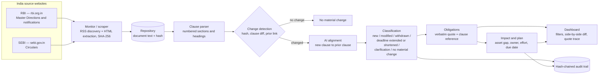

# Regula

**Regulatory Change Impact Agent** — tracks regulatory publications, detects what changed
against the earlier version, extracts the affected obligations and shows the impact on a
bank's policies, processes, systems and controls — with human review and a hash-chained audit
trail.

Built for the Azentio.ai Build Labs hackathon, Challenge 02.

---

## The problem

Compliance teams read circulars by hand, compare them with earlier instructions and work out
which internal policies, processes and systems must change. It is slow, inconsistent across
jurisdictions and hard to evidence to an auditor. Regula turns that reading into a traceable
decision chain: **regulation → clause → obligation → impacted asset → owner → approval**.

## What it does

- **Monitor** configured regulator sources and fetch new publications; keep a searchable
  repository with a content hash per document.
- **Understand** each document: numbered clauses, obligations with a verbatim quote and clause
  reference, deadlines, thresholds, applicability.
- **Compare** a publication with the earlier regulation it repeals or amends: side-by-side
  text, word-level redline, and a plain-English significance sentence.
- **Classify** every change: new obligation, modified, withdrawn, deadline extended, deadline
  shortened, clarification, or no material change.
- **Assess impact** against a control library (policies, processes, systems, controls), with a
  numeric gap, severity score and ownership.
- **Plan and prove**: owned tasks with due dates, human approval, and a SHA-256 hash chain over
  every extraction, approval and status change.

## Architecture



### How a change is detected

1. **New vs already processed** — the extracted text is hashed (SHA-256); an unchanged hash
   means the document is skipped. Each fetch records the document, its hash and timestamps.
2. **Which prior document** — explicit repeal/amendment references in the text (e.g. the 2025
   Directions repeal the 2022 Guidelines), confirmed by an AI relationship pass with a
   confidence score; below the floor it is flagged *unresolved* instead of guessed.
3. **Which clause changed** — the new document is parsed into numbered clauses and diffed
   against the prior document at word level: added, modified, removed.
4. **What kind of change** — an AI pass maps each clause to its prior counterpart and assigns
   one of the seven change classes plus a one-sentence significance. Deterministic rules still
   produce a class if the model is unavailable.
5. **Who decides** — every acceptance or rejection is a human action recorded in the audit
   chain.

### Sources

| Region | Authority | Website | Discovery |
|---|---|---|---|
| India | RBI | https://www.rbi.org.in/ | RSS: https://rbi.org.in/notifications_rss.xml |
| India | SEBI | https://www.sebi.gov.in/ | RSS: https://www.sebi.gov.in/sebirss.xml |
| KSA | SAMA | https://rulebook.sama.gov.sa/ | Rulebook circular listing (no RSS) |
| UAE | CBUAE | https://rulebook.centralbank.ae/ | Rulebook listing (no RSS; seed fallback) |

Neither Indian regulator publishes a JSON API; both publish RSS, which `POST /api/discover`
consumes. SAMA and CBUAE publish through rulebooks instead — the discovery step parses their
listing pages and falls back to a seeded publication when the site is unavailable, so the
repository always carries the configured jurisdictions.

The committed demo documents are the RBI **Digital Lending** pair:

- 2022 Guidelines — https://www.rbi.org.in/Scripts/NotificationUser.aspx?Id=12382&Mode=0
- 2025 Directions — https://www.rbi.org.in/Scripts/NotificationUser.aspx?Id=12848&Mode=0

`backend/scrape.py` reproduces both text files from those pages; `backend/data/scrape-manifest.json`
records the source URL and content hash.

## Repository

```
backend/
  serve.py              stdlib JSON API
  scrape.py             automated fetch + extraction for configured sources
  regula/
    ingest.py           clause parsing, prior alignment, redline
    extract.py          obligations with quotes, params, deadlines
    enrich.py           AI alignment, change class, significance
    changes.py          change taxonomy across the repository
    discover.py         source monitoring (feeds + offline mirrors)
    extract_api.py      manual upload / text extraction
    match.py            asset matching over the control library
    assess.py           severity, numeric gap, rationale, effort
    planner.py          owned tasks, dependencies, due dates
    pipeline.py         run orchestration
    audit.py            SHA-256 hash chain
    store.py            state, persistence, report export
  data/                 documents, prior versions, inventory, regulators
frontend/
  app/                  Next.js routes (dashboard, publication detail)
  components/dashboard/ dashboard, clause diff, obligation card, filters
  lib/                  contract types, domain adapters, state fetch
contracts/api.md        API contract
docs/                   requirements, plan, demo script
```

## Run it

**Backend** (Python stdlib only):

```bat
run.cmd                 :: starts backend/serve.py on :8787
python backend\serve.py --reset
python backend\scrape.py            :: refresh the India sources
python backend\scrape.py --check    :: fetch and compare without writing
```

**Frontend** (Next.js):

```bat
cd frontend
npm ci
npm run dev             :: http://localhost:3000
```

The frontend reads `GET http://127.0.0.1:8787/api/state` server-side and falls back to
`frontend/mock/state.json` with a visible degraded banner if the API is down.

**AI enrichment** is a direct OpenAI-compatible call (no provider abstraction, no offline
cache). Add a repo-root `.env`:

```ini
REGULA_LLM_BASE_URL=https://openrouter.ai/api/v1
REGULA_LLM_MODEL=z-ai/glm-5.3-flash
REGULA_LLM_API_KEY=...
```

Without a key the deterministic pipeline still runs; enrichment fields stay empty.

## API

| Method | Path | Purpose |
|---|---|---|
| GET | `/api/state` | Full workspace: sources, clauses, obligations, impacts, tasks, audit |
| GET | `/api/changes` | Classified change list with counts by class |
| GET | `/api/export/{sourceId}.md` | Assessment pack as markdown |
| POST | `/api/discover` | RSS discovery (RBI + SEBI), dedupe by URL, ingest newest directives |
| POST | `/api/extract` | Extract text and obligations from an uploaded document |
| POST | `/api/sources/{id}/run` | Analyse one publication |
| POST | `/api/impacts/{id}/review` | Approve or reject an impact |
| POST | `/api/tasks/{id}/status` | Move a task through its workflow |
| POST | `/api/reset` | Rebuild from seed |
| GET | `/api/health` | Liveness |

## Data honesty

The RBI documents are real and publicly available; the text is extracted from the official
notification pages. The 2025 Directions explicitly repeal the 2022 Guidelines. The control
library is a curated model of a mid-size Indian bank's KYC and lending stack, not an import
from a GRC system. The optional LLM is used for alignment, classification and significance;
every obligation still carries a verbatim quote and clause reference.

Known limits: PDF/OCR ingestion is not wired (HTML and text are), SEBI monitoring is
configured but not yet fetched live, scoring weights are hand-tuned for the demo, and approval
is a demo identity rather than SSO.

Roadmap: PDF extraction, live SEBI ingestion, scheduled monitoring, control-library import,
reviewer workflow and a labelled accuracy benchmark.
